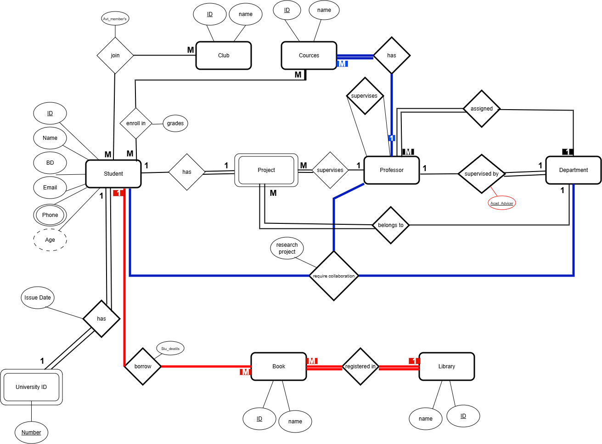

# 🎓 University Management & Academic Analytics System

An end-to-end relational database design, implementation, and business intelligence reporting project for an enterprise academic institution. This project covers conceptual data modeling (ERD), a normalized relational database schema (DDL & DML in T-SQL), and an executive 3-page interactive Power BI dashboard.

---

## 📌 Project Architecture

- **Conceptual Modeling (ERD):** Designed with Draw.io, establishing entity boundaries, cardinality constraints, and weak/identifying entity sets.
- **Relational Implementation (SQL Server):** 13 normalized tables adhering to 3NF/BCNF standards with full referential integrity and domain constraints.
- **Business Intelligence & Reporting:** Power BI Desktop (`.pbix`) report delivering academic, faculty, research, and campus resource insights.

---

## 🏗️️ 1. Conceptual Data Model (ERD)

The system models the following business domains and relationships:
- **Students & Identification:** 1:1 identifying relationship linking each `Student` to a dedicated `University_ID`.
- **Academic Departments & Faculty:** 1:M relationships linking `Department` to `Professor`, `Student`, and `Course`.
- **Course Enrollment & Grading:** Associative M:N entity `Course_Enrollment` tracking semester performance and grades.
- **Supervised Research Projects:** Multi-role student collaboration on faculty-led research initiatives.
- **Campus Life & Facilities:** Student participation across student clubs and campus library book borrowings.



---

## 💾 2. Relational Database Design (T-SQL)

The schema scripts are located in the `SQl/` directory and include:
- **Core Entities:** `Department`, `Professor`, `Student`, `University_ID`, `Course`, `Research_Project`, `Club`, `Library`, `Book`.
- **Associative / Junction Tables:** `Course_Enrollment`, `Student_Project_Collaboration`, `Club_Membership`, `Book_Borrowing`.
- **Integrity Rules:** Primary Keys, Foreign Keys with cascading actions, and domain `CHECK` constraints on grades, budgets, and book copy counts.

---

## 📊 3. Executive Power BI Dashboard

The Power BI report contains three dedicated analysis views:

### 🔹 Page 1: Overview
- **Key KPIs:** Total Students, Average Grade, Total Courses, Research Projects, Total Books Borrowed.
- **Visualizations:** Grade Distribution, Top 10 Departments by Academic Performance, Library Borrowing Status, Top Student Clubs by Participation.

### 🔹 Page 2: Academics & Faculty
- **Key KPIs:** Total Enrollments, Total Faculty, Student-to-Faculty Ratio, Overall Pass Rate.
- **Visualizations:** Grade Trends by Semester & Academic Year, Top 10 Challenging Courses, Faculty Distribution across Departments.

### 🔹 Page 3: Research & Campus Life
- **Key KPIs:** Active Research Grants, Student Researchers, Active Campus Clubs, Library Book Inventory.
- **Visualizations:** Student Research Roles, Campus Library Locations, Club Membership Distribution.

---

## 📁 Repository Structure

```text
university-management-system/
│
├── SQl/           # DDL & DML database creation and data population scripts, plus analytical example queries
├── powerbi/       # Interactive Power BI dashboard (.pbix)
├── diagrams/      # ERD source diagram (.drawio) and exported visuals
└── README.md      # Comprehensive project documentation
